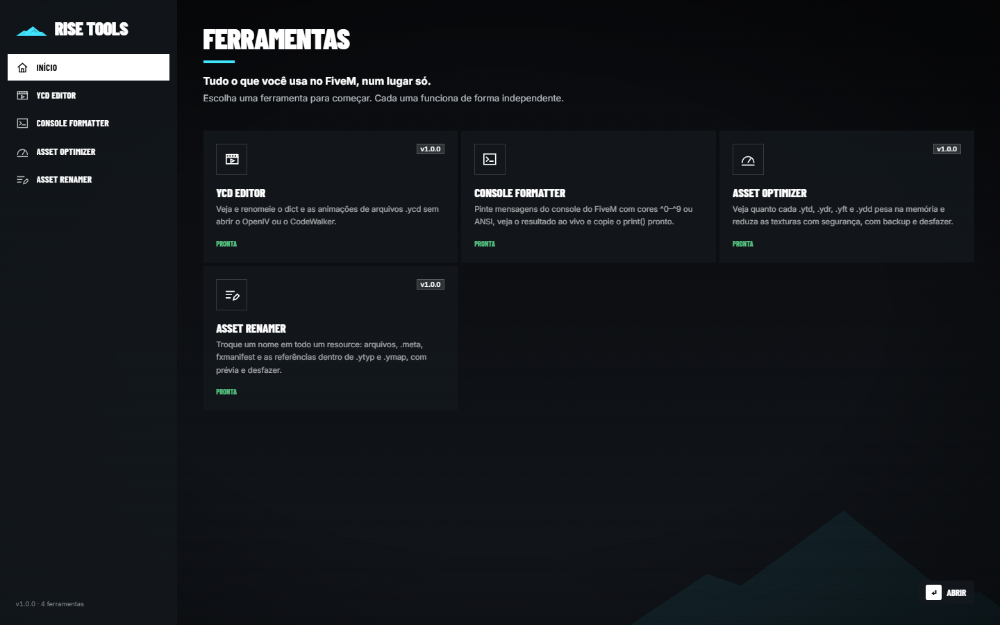
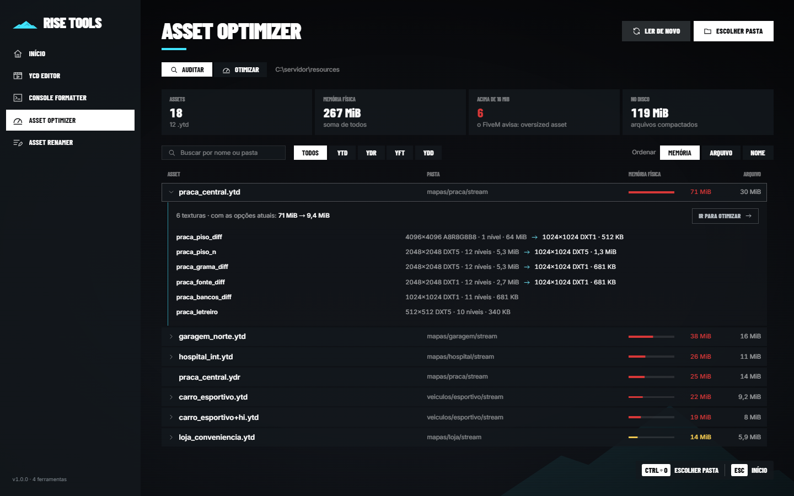
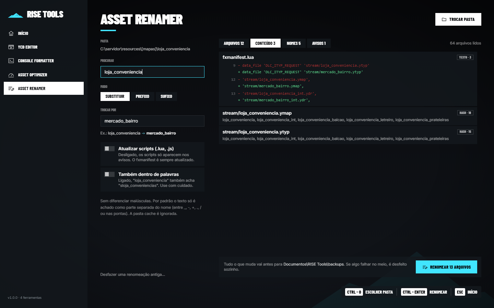

  

<h1 align="center">RISE Tools</h1>

  Ferramentas para FiveM num app só: edite animações, formate mensagens do console,
  enxugue texturas e renomeie resources inteiros, sem abrir o OpenIV ou o CodeWalker.

  <a href="https://github.com/RiseConcept/rise-tools/releases/latest"><b>⬇ Baixar a última versão</b></a>

## Download e instalação

1. Abra a [página de releases](https://github.com/RiseConcept/rise-tools/releases/latest).
2. Baixe uma das opções:
   - **`RISE-Tools_x.y.z_x64-setup.exe`**: instalador (recomendado). Cria atalho no menu Iniciar.
   - **`RISE-Tools_x.y.z_x64.msi`**: o mesmo, em formato MSI.
   - **`RISE-Tools_x.y.z_x64-portable.exe`**: sem instalar, é só abrir.
3. Pronto. Funciona offline.

Requer Windows 10 ou 11 (64 bits). O app usa o WebView2, que já vem no Windows 11; no Windows 10 o instalador baixa sozinho se faltar (a versão portátil não: nesse caso, use o instalador).

## Ferramentas

| Ferramenta | Para que serve |
|---|---|
| **YCD Editor** | Ver e renomear o dict e as animações de arquivos `.ycd` |
| **Console Formatter** | Colorir mensagens do console (`^0`–`^9` e ANSI) e copiar o `print()` pronto |
| **Asset Optimizer** | Ver quanto cada asset pesa na memória e reduzir as texturas dos `.ytd` |
| **Asset Renamer** | Trocar um nome em todo um resource sem quebrar as referências |

### YCD Editor

- **Visualizar:** arraste um `.ycd` (ou uma pasta) e veja o dict e todas as animações. Copie o nome da anim, o par `"dict", "anim"` pronto para o `TaskPlayAnim` ou todas de uma vez.
- **Editar:** renomeie o dict e as animações e clique em **Salvar cópia**. O original nunca é alterado: a cópia nova vai para a mesma pasta.

### Console Formatter

Digite a mensagem, selecione um trecho e clique numa cor. O preview mostra como fica no console e o botão **Copiar Lua** entrega o `print("...")` pronto. Tem modelos de Sucesso, Erro, Aviso e Informação.

### Asset Optimizer

1. **Escolha a pasta** do servidor (ou só a `resources`, ou um resource).
2. Na aba **Auditar** você vê a memória que cada `.ytd`, `.ydr`, `.yft` e `.ydd` ocupa e quais passam de 16 MiB (o limite em que o FiveM avisa *oversized asset*). Clique num `.ytd` para ver cada textura.
3. Na aba **Otimizar**, escolha o tamanho máximo das texturas e veja a simulação: quanto cada arquivo vai economizar, antes de mudar qualquer coisa.
4. Clique em **Otimizar**. Ao terminar, limpe a pasta `cache` do servidor e reinicie.

O que ele faz: reduz texturas grandes (sem perda quando a textura tem mipmaps), converte DXT5 sem transparência para DXT1 (sem perda, metade da memória), comprime texturas sem compressão e remove pixels que nenhuma textura usa.

### Asset Renamer

1. **Escolha a pasta** do resource.
2. Digite o texto a procurar e o novo (ou um prefixo/sufixo).
3. Confira a prévia: arquivos renomeados, linhas alteradas, nomes trocados e avisos.
4. Clique em **Renomear**.

Ele renomeia os arquivos, atualiza o `fxmanifest`, os `.meta`/`.xml`/`.json` e as referências dentro dos `.ytyp` e `.ymap`. Os scripts `.lua`/`.js` só mudam se você ligar a opção. Por padrão o nome só é achado inteiro: `carro` acha `prop_carro_01`, mas não `scarro`.

## Seus arquivos estão seguros

- **Nada muda sem você ver antes.** As ferramentas que alteram arquivos mostram uma prévia completa.
- **Backup automático.** Antes de alterar, os originais são copiados para `Documentos\RISE Tools\backups`.
- **Desfazer.** O botão **Desfazer** aparece ao terminar; backups antigos podem ser restaurados pela própria ferramenta.
- **Se algo der errado no meio, nada fica pela metade.** O arquivo novo é conferido antes de substituir o antigo, e o Asset Renamer desfaz tudo sozinho em caso de erro.

## Atalhos

| Tecla | Ação |
|---|---|
| `Esc` | Voltar ao início |
| `Ctrl + O` | Abrir arquivo ou pasta |
| `Ctrl + S` | Salvar (YCD Editor, modo Editar) |
| `Ctrl + Enter` | Renomear (Asset Renamer) |
| `Ctrl + Shift + C` | Copiar Lua (Console Formatter) |

Também dá para **arrastar** arquivos e pastas do Explorer para a janela.

## Para desenvolvedores

Como rodar, gerar o instalador, a arquitetura modular e como adicionar uma ferramenta: [docs/DESENVOLVIMENTO.md](docs/DESENVOLVIMENTO.md).
